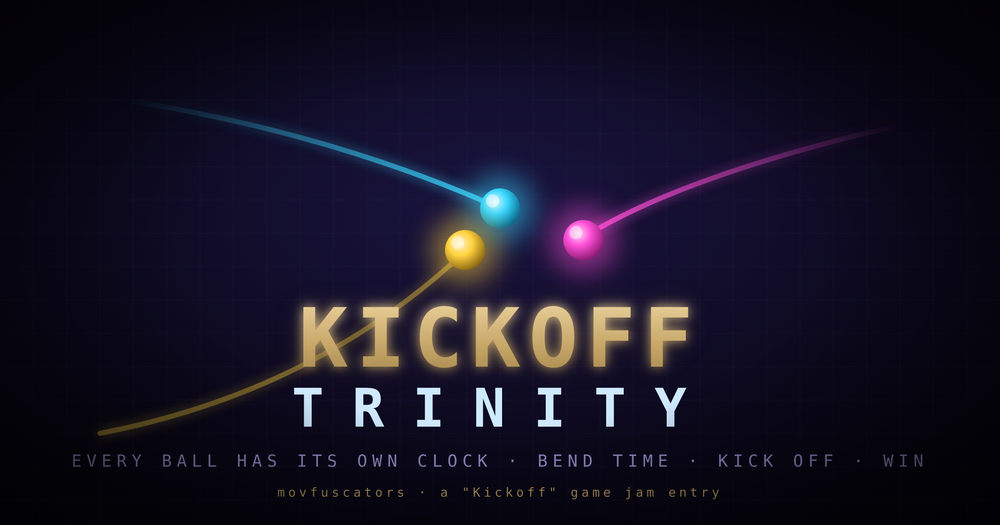

# Kickoff Trinity



A 2D time-manipulation puzzle game built for the **"Kickoff"** game jam.

Every ball has its own clock. You *kick off* each ball, then bend its **local time** —
fast-forward, freeze, or rewind it independently of the others — to open time-gates,
launch frozen balls like loaded springs, and thread collisions across timelines that no
longer agree on "now." Win by landing every ball in its colour-matched goal at the **same
global instant**.

The twist that makes it hard (and fun): the simulation is the single source of truth, so a
ball can genuinely reverse **back through a door it just opened** — cause and effect are
yours to renegotiate.

---

## Team

- **Team name:** movfuscators
- **Members:**
  - Mohammad Kamrul Hasan
  - Zabir Zamee
  - Siam Rafsan Prionto

## Engine / framework

**No off-the-shelf game engine.** The game runs on a custom, dependency-free stack:

- **Language:** TypeScript 5 (strict)
- **Bundler / dev server:** Vite 5
- **Rendering:** HTML5 Canvas 2D (game world) + a DOM overlay (HUD & per-ball clocks)
- **Physics:** a bespoke **deterministic 2D engine** — fixed-timestep semi-implicit Euler
  at 120 Hz, exactly reversible, with independent per-ball clocks. No physics library.
- **Audio:** procedural Web Audio (synthesized at runtime, no audio assets)
- **Tests:** Vitest 2

## Project link

- **GitHub:** `https://github.com/<your-org>/kickoff-trinity` *(replace with the real
  repository URL before submitting)*

## Description

Kickoff Trinity re-skins a time-bending puzzle as a series of *kickoffs*. Launching a ball
is a kickoff; rewinding and replaying it is a re-kickoff; winning is the ultimate kickoff.

Each ball carries a **local clock** and a time-speed you can dial between −2× and +2×
(including a full freeze at 0×). Because balls run on independent clocks:

- **Time-gates** stay open only while their switches are held — so one ball can pause on a
  plate to hold a door while another rolls through.
- **Frozen balls store impulses.** Ram a paused ball and it doesn't move… until you unpause
  it, launching it along the stored velocity like a spring.
- **Rewinding is real physics, not a replay.** A ball reversing through an open door, or
  re-colliding as it moves backward, all happens live against the current world.

Solve each level by getting all balls into their matching goals **simultaneously**.

## Installation

Requires **Node.js 18+**.

```bash
# install dependencies (TypeScript, Vite, Vitest — no runtime deps)
npm install

# run the game locally (opens a dev server, default http://localhost:5173)
npm run dev
```

Other useful scripts:

```bash
npm run build      # type-check + production build into dist/
npm run preview    # serve the production build
npm test           # run the unit test suite once
npm run typecheck  # strict type-check, no emit
```

Load a specific level directly with a query param, e.g. `http://localhost:5173/?level=3`
(1-based). Your furthest-reached level is saved automatically and resumed on the next visit.

## How to play

The game has two phases per level.

### 1. Kickoff phase

- **Click and drag** from a glowing cannon to aim, then release to **kick off** that ball.
  Drag length sets the launch power. Kick off all the balls to enter time mode.

### 2. Time phase

| Key | Action |
| --- | --- |
| `1` / `2` / `3` | Select a ball |
| `W` | Play the selected ball forward (1×) |
| `S` | Freeze the selected ball (0×) |
| `X` | Reverse the selected ball (−1×) |
| `Q` / `E` | Step its time-speed down / up (−2×…+2×) |
| `Space` | Global pause (freezes everything) |
| `M` | Mute / unmute |
| Hold `R` | Reset the level |
| `Enter` / click | Advance to the next level once you've won |

**Goal:** manoeuvre every ball into its colour-matched goal ring (cyan / magenta / yellow)
so they're **all occupied at the same moment**. The per-ball clocks at the bottom show each
ball's local time and direction.

Tip: freezing a ball *parks* it — useful for holding a switch, or for pinning a ball in its
goal while you orchestrate the rest.

## Branding & press kit

Logo, cover, banner, and the colour palette (with itch.io theme mapping) live in
[`assets/`](assets/) — see [`assets/BRAND.md`](assets/BRAND.md). Art is authored as
editable SVG and rasterized to 2× PNG.

---

*Built with a custom deterministic engine — see `CLAUDE.md` for the architecture notes and
`prd.md` / `prd_2.md` for the full and jam-scoped design specs.*
